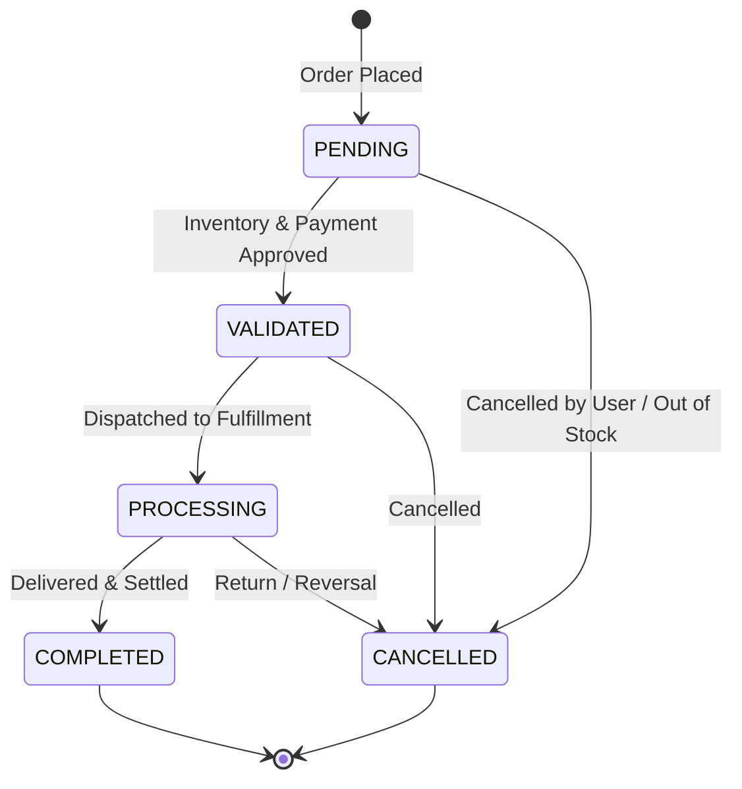

# ⚡ Cloud-Native Order Service

[](https://github.com/MSBHOSLE/cloud-native-order-service/actions)
[](https://fastapi.tiangolo.com)
[](https://www.python.org/)
[](https://www.postgresql.org/)
[](https://www.docker.com/)
[](LICENSE)

A resilient, cloud-native **Order Processing Microservice** engineered with domain state machine lifecycle invariants, guaranteed **HTTP idempotency controls**, and comprehensive automated test coverage.

---

## 🏗️ Order Lifecycle State Machine



---

## ⚡ Core Engineering Highlights

1. **Guaranteed Idempotency Key Processing**:
   - Accepts client-supplied `Idempotency-Key` headers on order creation.
   - Prevents duplicate order placements and double-charging during network retries or transient connection timeouts.

2. **Domain-Driven Invariant Enforcement**:
   - Mathematical precision on unit totals, tax rates, and aggregate calculations.
   - Enforces strict unidirectional state machine transitions; attempts to perform invalid jumps (e.g. `PENDING` -> `COMPLETED`) raise 409 Conflict.

3. **Cloud-Native & Kubernetes Ready**:
   - Built-in `/health/live` and `/health/ready` probe endpoints for container orchestration.
   - Clean separation of domain, service, and transport layers.

---

## 📡 API Reference

| Method | Endpoint | Description |
| :--- | :--- | :--- |
| `POST` | `/api/v1/orders` | Create new order (supports `Idempotency-Key` header) |
| `GET` | `/api/v1/orders/{order_id}` | Retrieve order details & state |
| `PATCH` | `/api/v1/orders/{order_id}/status` | Transition order status |
| `POST` | `/api/v1/orders/{order_id}/cancel` | Cancel order |
| `GET` | `/api/v1/orders` | List customer orders |
| `GET` | `/health/live` | Kubernetes Liveness probe |
| `GET` | `/health/ready` | Kubernetes Readiness probe |

---

## 🚀 Quickstart

```bash
git clone https://github.com/MSBHOSLE/cloud-native-order-service.git
cd cloud-native-order-service

# Start with Docker Compose
docker compose up -d --build
```

---

## 🧪 Testing

```bash
python -m unittest discover tests
```

---

## 👤 Author

**Mahesh Sanjayrao Bhosle**
- **GitHub:** [@MSBHOSLE](https://github.com/MSBHOSLE)
- **LinkedIn:** [Mahesh Bhosle](https://linkedin.com/in/mahesh-bhosle-916991198)
- **Email:** msbhosle.2@gmail.com
- **Education:** M.Sc. Data & Computer Science, Heidelberg University

---

## 📄 License

This project is licensed under the MIT License - see the [LICENSE](LICENSE) file for details.
